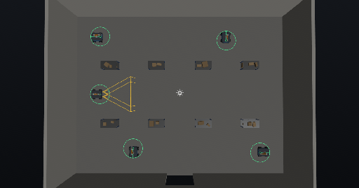
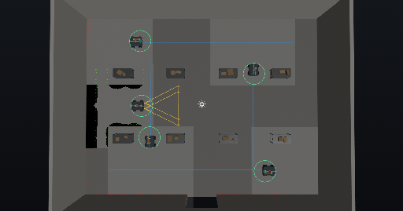

# Zenoh Five-Robot Warehouse Experiment

Five Mobile Manipulator robots navigate simultaneously through the in-process warehouse simulation using native Zenoh and one external navigation stack per robot. This project records the completed 2026-10-15 performance experiment.

## Quick start

From this project folder:

```bash
python3 scripts/quickstart.py setup   # check prerequisites and prepare the project
python3 scripts/quickstart.py test    # smoke test in RobotLens
python3 scripts/quickstart.py         # setup, then test
```

The test does not start the external navigation stacks; use the run guide below for that.

`test` uses the running RobotLens session if there is one. Otherwise it starts RobotLens from
`../../RobotLens` (build it first with `./build.sh`) and closes it at the end, keeping its log
in `evidence/quickstart/robotlens.log`. The test checks that:

- the project opens
- communication starts and connects
- `scripts/setup_fleet.sh` prepares the scene and starts the simulation
- the robots are loaded: `Mobile_manipulator`, `Mobile_manipulator_copy`, `…_copy_4`
- a viewport screenshot is saved to `evidence/quickstart/quickstart.png`

It then stops navigation, the simulation, and communication, in that order. `--keep-running` leaves the simulation and RobotLens running for a look.
The shared code is in `../tools/quickstart.py`.

## Contents

- [Requirements](#requirements)
- [Layout](#layout)
- [Fleet](#fleet)
- [Run guide](#run-guide)
- [Results](#results)
- [Known limits](#known-limits)

## Requirements

| Requirement | Purpose |
| --- | --- |
| RobotLens with Zenoh support | Project editor, in-process MuJoCo simulation, and Zenoh communication |
| `Zenoh-motion-stacks/build/system/zms_navigation` | One external navigation process per robot |
| Python 3 and RobotLens automation client | `scripts/mcp.py` MCP wrapper |
| A running RobotLens session | Required before the setup and goal scripts are used |

`stacks/run_fleet.sh` finds `zms_navigation` through `$ZMS_BIN`, then `PATH`, then `../../../Zenoh-motion-stacks/build/system`. The navigation stack installation is shared and was not edited for this experiment.

## Layout

| Path | Purpose |
| --- | --- |
| `.robotlens/zenoh-mujoco-5mobile-manipulator-warehouse-fleet.xml` | Zenoh workspace and MuJoCo project |
| `worlds/warehouse.xml` | Warehouse world: x ±8.3, y ±6.4; rack rows near y ±2.2 |
| `robots/Mobile_manipulator.urdf` | Four-wheel skid-steer mobile manipulator with a 2D LiDAR on `lidar_link` |
| `stacks/navigation-robot1.json` through `navigation-robot5.json` | Temporary per-robot external-stack settings |
| `stacks/run_fleet.sh` | Starts and owns five navigation processes |
| `scripts/mcp.py` | Project-local MCP helper |
| `scripts/setup_fleet.sh` | Imports, places, configures, bridges, and starts the fleet simulation |
| `scripts/send_goals.sh` | Sends every goal and prints a terminal-state progress table |
| `evidence/` | Captured run evidence |

## Fleet

| Robot | Scene name | Start `(x, y, yaw)` | Goal `(x, y)` |
| --- | --- | --- | --- |
| robot1 | `Mobile_manipulator` | `(-6.5, 0, 0°)` | `(6.5, 0)` |
| robot2 | `Mobile_manipulator_copy` | `(-3.6, -4.5, 90°)` | `(-3.6, 4.5)` |
| robot3 | `Mobile_manipulator_copy_2` | `(3.6, 4.5, -90°)` | `(3.6, -4.5)` |
| robot4 | `Mobile_manipulator_copy_3` | `(-6.5, 4.5, 0°)` | `(6.5, 4.5)` |
| robot5 | `Mobile_manipulator_copy_4` | `(6.5, -4.5, 180°)` | `(-6.5, -4.5)` |

Each namespace uses `robotN/cmd_vel`, `robotN/odom`, `robotN/scan`, `robotN/joint_states`, `robotN/cmd_joints`, and `robotN/navigation/*`. The stopgap configuration applies `scan_offset = {x: 0.32, y: 0, yaw: 0}`, `scan_ignore_radius = 0.5`, and enabled avoidance. RobotLens managed mode is expected to generate these configurations later.

## Run guide

1. Launch RobotLens yourself, then open a terminal at this project root.

2. Configure the live fleet:

   ```bash
   ./scripts/setup_fleet.sh
   ```

   The script opens the project, reuses saved robots and imports only missing instances, resolves exact session aliases with `scene.find`, applies poses and Zenoh attach-mode navigation, removes duplicate LiDARs, sets ray-based LiDAR settings, starts comms and simulation, and enables each MuJoCo bridge. Repeating setup does not import another four robots.

3. Setup enables every 2D LiDAR through MCP and assigns its native `robotN/scan` key explicitly. Inspect live sensor readiness before sending goals. Script behavior has mocked regression coverage; this is not new live fleet acceptance evidence.

4. In a second terminal, start the external stacks:

   ```bash
   ./stacks/run_fleet.sh 5
   ```

5. Send and watch all five goals:

   ```bash
   ./scripts/send_goals.sh
   ```

6. For evidence, use `view.set_camera` with `{ "x": 0, "y": 0, "z": 0, "yaw": -90, "pitch": 89, "distance": 18 }`, then `robotlens.capture_viewport_screenshot`; use `robotlens.collect_performance_snapshot` for the performance sample.

7. Stop RobotLens and the fleet script by their owning PIDs.

The scripts derive the project location at runtime. `project.open` receives an absolute path only because that MCP command requires one; no machine-specific path is stored in the project.

## Results

Latest functional verification, 2026-10-17: all five goals were picked by dragging in the actual viewport, dispatched within 7.8 seconds, and executed concurrently with LiDAR avoidance enabled. All five native results reported success within 46.9 seconds of the first dispatch. An independent Zenoh subscriber measured final position errors of 0.141–0.142 m against the picked goals, inside the configured 0.15 m tolerance. No ROS/Nav2 process or external-stack modification was used. The enabled sensor configuration was saved through RobotLens.

This is a functional movement check, not a performance comparison. An earlier slow, staggered dispatch left robot3 parked in robot4's route until robot4 reported `no_progress`; the concurrent rerun passed without weakening avoidance or increasing timeouts.

RobotLens RelWithDebInfo, 2026-10-15, five robots:

| Measure | Result |
| --- | --- |
| Goal completion | All five succeeded in about 30 s |
| Final positions | robot1 `(6.3, 0)`, robot2 `(-3.6, 4.3)`, robot3 `(3.6, -4.3)`, robot4 `(6.3, 4.5)`, robot5 `(-6.3, -4.5)` |
| Idle performance | 59.8 FPS |
| Five robots driving | 59.9 FPS |
| Display cap | 60 FPS |
| Avoidance during measured run | Disabled because copied LiDARs were not enabled |





## Measuring FPS

Use the same display cap for both projects before comparing results: Settings → Appearance → VSync, enabled for a 60 FPS cap or disabled for uncapped measurement. After the scene is idle for 10 seconds, call `robotlens.collect_performance_snapshot`; repeat while all five goals are executing. Record the reported FPS, frame-time statistics, cap setting, and whether the sample was idle or driving.

## Known limits

- The current saved project contains five robot instances; unsaved live edits still require saving in RobotLens.
- LiDAR enablement and per-robot key assignment are configured by setup through MCP.
- Reload can create duplicate 2D LiDAR sensors; setup removes duplicates.
- Per-robot stack configuration files are manual until RobotLens managed mode generates them.
